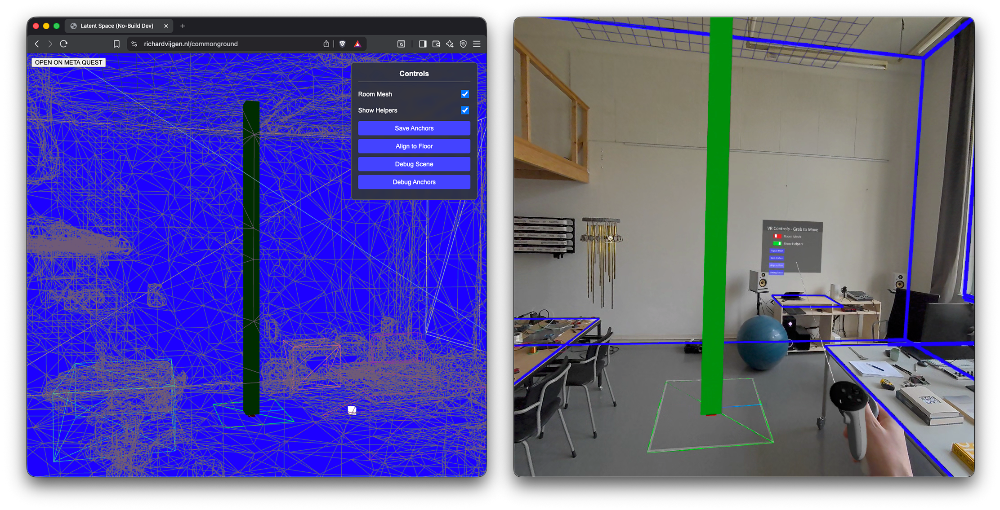

# Commonground

Commonground is a multi-user WebXR library for persistent room-aware scene placement and helper tooling based on Three.js + RATK.

- Remote storage of persistent anchors and room mesh
- Broadcast persistent anchors to multiple clients
- Desktop view displays room mesh and object placement
- Immersive controls for object placement



## Structure

- `src/`: client library source code, including `CommonGround`
- `server/`: `createServer` factory (`server/index.js`), `AnchorStore` persistence (`server/AnchorStore.js`), and a CLI entry (`server/server.js`)
- `examples/`: example apps — `test-cube/` (minimal cube, the default webpack entry), `basic/` (depth-occlusion demo), `video-test/` (video texture helper)
- `scripts/`: utility scripts, including the webpack runner

## Package entry points

```js
import { CommonGround } from 'commonground';          // client library
import { createServer } from 'commonground/server';   // server factory
```

## Quick Start

```bash
npm install
npm run server -- --space myspace
```

Open `http://localhost:3001/` for the no-build dev mode of the test-cube example.

## Build

```bash
npm run build
```

Builds `examples/test-cube/` into `dist/`.

## Server

One server instance serves one **physical space**. Anchors and room meshes are stored per space:

```
server/data/spaces/<spaceId>/anchors.json
server/data/spaces/<spaceId>/mesh.json
```

The CLI defaults to the `default` space; pass `--space <id>` to pick another:

```bash
node server/server.js --space adrie            # also --data-dir, --http-port, --https-port
```

HTTP runs on port 3001 and HTTPS (self-signed dev certificate in `server/.certs`) on 3002.

### API endpoints

All endpoints are mounted at `/`, `/commonground/`, and any caller-provided aliases:

- `GET/POST/DELETE /api/anchors` (legacy alias `/anchors`) — persistent anchor references; `?device=N` scopes keys as `device_<id>_<key>`
- `GET/POST /api/mesh` (legacy alias `/mesh`) — room mesh export
- `POST /api/roommesh`, `GET /api/roommesh[/:sessionId]` — legacy per-session room meshes
- `GET /api/client-config` — client runtime config (`{ syncDefault, headsets: [{ id, label, color? }] }`;
  `color` passes through only when DOM-safe — ANSI SGR escape strings are stripped)
- `GET /api/headsets` — live per-headset overview for the desktop HUD:
  `[{ id, label, connected, connectedDurationMs (null when disconnected),
  immersedAt, immersedDurationMs (null until immersion enter), status
  (merged cg:status state or null), columns: string[] (only when columns
  are configured), anchor: 'anchored' | 'no-anchor' | 'unknown' }]`.
  Presence and immersion come from the socket relay (handshake deviceId);
  anchor state refers to the currently selected space.
- `GET /api/spaces` — `{ current, spaces: string[] }` (subdirs of
  `<dataDir>/spaces/`, always including the current space)
- `POST /api/spaces` `{ name }` — create a space (1–64 chars: letters,
  digits, space, `- . _`); does not switch to it
- `POST /api/spaces/select` `{ name }` — switch the runtime space: the
  AnchorStore re-points at `<dataDir>/spaces/<name>/` and the server
  broadcasts `cg:space`, so connected clients re-run their anchor
  fetch/apply path without a reload (404 for unknown spaces)
- `GET /commonground/logs` — integrated session log viewer (HTML)
- `GET /commonground/api/session-logs` — raw NDJSON session log contents (empty when no sessions yet)

### Embedding the server

```js
import { createServer } from 'commonground/server';

const { app, httpServer, httpsServer, store, listen } = await createServer({
	spaceId: 'adrie',                 // default 'default'
	dataDir: '/path/to/data',         // default <package>/server/data
	httpPort: 3001,
	httpsPort: 3002,
	apiAliases: ['/sites/ADRIE/XR'],  // extra prefixes for the anchor/mesh API
	syncDefault: true,                // client sync participation default (client-config endpoint)
	headsets: [{ id: 1, label: 'Headset 1' }],  // project headsets for the HUD overview
	                                    // (DOM-safe fields only; terminal colors stripped)
	headsetColumns: [{ render: (status) => `Intro step: ${status.introductionStep ?? 0}` }],
	                                    // dashboard columns rendered per headset in
	                                    // GET api/headsets — must return PLAIN TEXT
	                                    // (ANSI escapes show raw in the browser)
	headsetDefaultStatus: {},           // merged under the cg:status state before
	                                    // rendering columns (CLI passes the project's
	                                    // createDefaultStatus()/statusFields default)
	getRelayRuntime: () => relay,       // lazy relay accessor for presence/status/
	                                    // broadcast (the relay attaches after
	                                    // createServer; cli.js wires this)
	sessionLogFile: '/path/to/data/logs/headset-sessions.ndjson',  // default <dataDir>/logs/...
	sessionLogTitle: 'Session Logs',  // log viewer page title
	extraRoutes: (app, { store, spaceId }) => {
		app.get('/test-video', (req, res) => res.sendFile('/path/to/video.mp4'));
	},
	apps: [
		{ path: '/my-app', staticDir: '/path/to/app/dist', indexFile: 'index.html' },
	],
	serveExample: false,              // true serves the bundled example app
});

listen(); // or call httpServer.listen(...) yourself
```

Environment variables: `HTTP_PORT`, `HTTPS_PORT`, `QUIET_LOGS=1`, `COMMONGROUND_HTTPS_CERT_DIR`, `COMMONGROUND_LOG_CLEAR_SECONDS`, `COMMONGROUND_LOG_CLEAR_FORCE=1`.

### Socket relay + status channel

`commonground/server` also exports socket.io plumbing that attaches to the
factory's HTTP and HTTPS servers and relays events between them, so clients
on either protocol share one event stream. Two generic channels are built in
(on by default; disable with `sync: false` / `status: false`):

- **`cg:sync`** — cross-headset event channel. Clients emit `{ type, payload }`;
  the server stamps `deviceId` (typo-tolerant handshake query) and `at`, and
  relays `{ type, payload, deviceId, at }` to every OTHER client. The sender
  never gets its own echo. Spectator clients (handshake `clientRole=screen`)
  receive broadcasts but their emits are ignored.
- **`cg:status`** — dumb per-device merge store. Clients emit partial state
  objects; the server shallow-merges into the device's last-known state,
  logs `[status] {"deviceId":N,"state":{...},"at":ms}` (dashboard contract),
  and broadcasts `{ deviceId, state, at }` to all clients. Disconnect clears
  the device entry.

```js
import { createServer, attachSocketRelay } from 'commonground/server';

const server = await createServer({ spaceId: 'adrie' });
const relay = attachSocketRelay(
	[
		{ server: server.httpServer, label: 'http' },
		{ server: server.httpsServer, label: 'https' },
	],
	{
		socketPath: '/socket.io/',
		quiet: false,          // gates [socket] <event> relay logs
		sync: true,            // built-in cg:sync channel
		status: true,          // built-in cg:status channel
		onLog: (line) => {},   // sink for structured lines ([socket:...]/[status]...);
		                       // pass dashboard.writeLogLine for in-process dashboards
		hasEnteredImmersion: (state) => Boolean(state?.enteredImmersion),  // default;
		                       // marks relay.immersion when the merged state first passes
	},
);

relay.coreStatus.get(3); // -> merged cg:status state for device 3 (null after disconnect)
relay.presence.get(3);   // -> { connectedAt } while device 3 is connected, else null
relay.presence.keys();   // -> currently connected deviceIds (handshake deviceId;
                         //    multiple sockets per device ref-count; screens untracked)
relay.immersion.get(3);  // -> immersion-enter timestamp (ms) for device 3, else null

// Declarative validate -> log -> broadcast event relay (custom protocols)
relay.registerRelayEvents([{
	event: 'tileGrabSync',
	validate: (payload, socket) => {
		if (!payload || !Array.isArray(payload.matrix)) return null; // null drops the event
		return { sourceSocketId: socket.id, payload, at: Date.now() };
	},
	log: (message) => ({ sourceSocketId: message.sourceSocketId }), // optional
	onEvent: (message, socket) => {},                               // optional
}]);

// Custom per-device status aggregation (legacy protocols)
const status = relay.registerStatusChannel({
	createEntry: () => ({ state: { enteredImmersion: false } }),
	reduce: (entry, message) => {
		if (message.state.enteredImmersion) entry.state.enteredImmersion = true;
	},
});
status.getStatus(3); // -> aggregated state for device 3 (null after disconnect)
server.listen();
```

Connection lifecycle is logged in a dashboard-scrapable format:
`[socket:<label>] connected|disconnected client <id>` (or a custom label from
the `clientRole` handshake query, e.g. `screen`).

Also exported: `parseDeviceIdQuery(query)` — typo-tolerant deviceId parsing
(`deviceId`/`deviceid`/`deviced`) — and `normalizeSocketIoUrl(server)` which
collapses `//socket.io` URLs seen behind some reverse proxies.

### `commonground serve` (CLI)

The package ships a config-driven CLI (`"bin": { "commonground": "cli.js" }`).
In any app directory:

```bash
npx commonground serve [--space <id>] [--config <path>] [--http-port <port>] [--https-port <port>]
```

With **no config at all** it serves the current directory at `/`, the
anchors/mesh API, and the cg.sync/cg.status socket channels — no dashboard.
It always also mounts the client library for no-build import maps:
`/commonground/src` → the package's `src/`, `/commonground/node_modules` →
the node_modules root providing three/ratk (hoisting-safe).

All settings are optional and come from `commonground.config.js` in the
current directory (default export); `--space` overrides `config.space`:

```js
export default {
	space: 'default',                 // --space overrides
	httpPort: 3001,
	httpsPort: 3002,
	dataDir: 'data',                  // resolved against cwd
	certDir: '.certs',                // resolved against cwd
	sync: true,                       // built-in cg:sync channel
	status: true,                     // built-in cg:status channel
	syncDefault: true,                // client sync participation default (--sync/--no-sync override)
	sessionLogTitle: 'Session Logs',  // title of the /commonground/logs viewer
	routes: [{ path: '/screen', file: 'screen.html', label: 'Screen' }],  // label → helper-page quick link
	staticDirs: [{ path: '/assets', dir: 'public/assets', indexFile: null }],
	extraRoutes: (app, { store, spaceId }) => {},  // escape hatch
	setupRelay: (relay) => {},                     // escape hatch (registerRelayEvents etc.)
	dashboard: {                      // presence enables the in-process dashboard
		enabled: true,
		headsets: [{ id: 1, label: 'Headset 1', color: '#ff4902' }],  // hex → ANSI in the TUI
		columns: [{ render: (status, headset) => `...` }],
		statusFields: {                 // declares the status shape once; derives
			introductionStep: 'number',           // the default status and the
			enteredImmersion: 'boolean',          // session-log entry (see below)
			lastTileDraggedTitle: 'string',
			lastFloorplanHex: 'number?',          // nullable
			tileGrabHistory: [{ title: 'string' }],  // event array: entry schema
		},
		createDefaultStatus: null,      // optional override (derived from statusFields)
		applyStatusState: (status, state, payload) => ({ ...status, ...state }),
		hasEnteredImmersion: (state) => Boolean(state.enteredImmersion),
		summarizeSession: null,         // optional override (derived from statusFields)
		sessionLogFile: 'data/logs/headset-sessions.ndjson',
		helperPage: {},                 // fully generated page; or override:
		// helperPage: {
		// 	port: 80, fallbackPort: 3000,
		// 	title: 'Quest Links', heading: 'Headset Launch', description: '...',
		// 	links: [{ label: 'Screen', href: 'https://{host}:3002/screen' }],
		// 	headsetLinks: [{ label: 'Headset {id}', href: 'https://{host}:3002?deviceid={id}' }],
		// },
	},
};
```

With `dashboard` present, server and dashboard run in ONE process: the
relay's structured log lines feed the dashboard directly (`onLog`), no child
processes or stdout scraping involved. Session NDJSON logging, the helper
page, and the alt-screen TUI (when `QUIET_LOGS=1` and a TTY) all work. The
CLI also injects two things the dashboard cannot know on its own —
`appHttpsPort` (the serve HTTPS port) and `appRoutes` (the top-level
`routes`) — used to generate the default helper-page links; a project's
dashboard section may override both.

### Status fields (`statusFields`)

Declare the project's status shape once; the framework derives both the
default status and the session-log entry from it. Field types: `'number'`,
`'boolean'`, `'string'`, nullable `'number?'`/`'string?'`, and event arrays
written as a one-element array holding the entry schema
(`[{ title: 'string', box: 'string' }]`).

Derived default status: number → `0`, boolean → `false`, string → `'none'`,
nullable → `null`, event array → `[]`. The derived default also carries
`lastAction: 'none'` (the conventional client-stamped field of cg.status
updates). Derived session entry: always the standard envelope
(`type: 'headset-session-ended'`, `sessionId`, `headsetId`, ISO
`connectedAt`/`immersedAt`/`endedAt`, `connectedDurationMs`,
`immersedDurationMs`) plus a `status` section with exactly the declared
fields — scalars coerced per type (string → trimmed `'none'` fallback;
boolean → `!!v`; number → finite-or-`0`; nullable → `null` for
null/undefined, else integer-or-`null` / trimmed-or-`null`), event arrays
mapped through `toSessionMsEvents` with each entry normalized to exactly the
declared entry fields (declared order) plus `sessionMs`.

Override hierarchy: an explicit `createDefaultStatus` / `summarizeSession`
hook always wins over the derived version; without `statusFields` the
framework falls back to an empty default status and the generic envelope
with the raw final status. `columns` is unaffected. The derived builders are
exported as `createStatusFromFields(statusFields)` and
`summarizeSessionFromFields(statusFields)` for projects that want to wrap
them.

### Helper page defaults

With `helperPage: {}` (or `true`) the launch page is fully generated:
`CommonGround` → `/api/anchors` (certificate accept), one quick link per
top-level route that has a `label` (routes without `label` are skipped),
`Session Logs` → `/commonground/logs`, `Desktop` → `/`, and per-headset
`Headset {id}` / `Headset {id} Admin` links (`?deviceid={id}[&admin=1]`) —
all against `https://{host}:<appHttpsPort>`. `port`/`fallbackPort` and the
cosmetic `title`/`heading`/`description` keep their meaning; explicit
`links`/`headsetLinks` replace the generated lists entirely. Without an
`appHttpsPort` (standalone classic-mode dashboards) the generated lists are
empty.

### Dashboard

`commonground/dashboard` generalizes the terminal operations dashboard:
it renders an alt-screen status table, appends NDJSON session summaries, and
serves a headset launch helper page. It can either spawn child server
processes and scrape their log lines (classic mode), or run in-process fed
by a socket relay's `onLog` (what `commonground serve` uses).

```js
import { runDashboard } from 'commonground/dashboard';

runDashboard({
	title: 'My App Dashboard',
	headsets: [
		{ id: 1, label: 'Headset 1', color: '#ff4902' },  // hex ('#ff4902'/'#f40') or ANSI escape
		{ id: 2, label: 'Headset 2', color: null },
	],
	columns: [{ render: (status) => `Intro step: ${status.introductionStep ?? 0}` }],
	createDefaultStatus: () => ({ introductionStep: 0, enteredImmersion: false }),
	applyStatusState: (status, state) => ({ ...status, ...state }),   // default
	hasEnteredImmersion: (state) => Boolean(state.enteredImmersion),  // default
	summarizeSession: null,             // optional custom NDJSON entry builder
	processes: [                          // optional; omit for in-process mode
		{ name: 'my-server', command: process.execPath, args: ['./server.js'] },
	],
	handleSignals: true,                  // false when the host manages shutdown
	sessionLogFile: './data/logs/headset-sessions.ndjson',
	helperPage: {
		port: 80, fallbackPort: 3000,
		title: 'Quest Links', heading: 'Headset Launch', description: '...',
		links: [{ label: 'Screen', href: 'https://{host}:3004/screen' }],
		headsetLinks: [
			{ label: 'Headset {id}', href: 'https://{host}:3004?deviceid={id}' },
			{ label: 'Headset {id} Sync', href: 'https://{host}:3004?deviceid={id}&sync=1' },
		],
	},
});
```

Child processes must print the scraped line formats to stdout:
`[socket:<label>] connected|disconnected client <id>` and
`[status] {"deviceId":<id>,"action":"...","state":{...},"at":<ms>}`
(exactly what `attachSocketRelay` emits). In-process mode wires those same
lines directly: `attachSocketRelay(servers, { onLog: dashboard.writeLogLine })`.

The alt-screen TUI is enabled when `QUIET_LOGS=1` and stdout is a TTY;
otherwise child logs pass through while parsing/session logging stay active.

In TUI mode the frame is the only thing written to the terminal, and it
always redraws in place: repaints happen only on the `refreshMs` cadence
(log lines never trigger a repaint, so a burst of status events — e.g.
per-pointer-move updates — cannot flood the terminal), recent-log lines are
truncated to the terminal width, and the log area is capped to the remaining
screen rows (overflow is summarized as `... N older log line(s) hidden`).
Notices such as `[dashboard] Session #N started for headset <id>` go to the
TUI's recent-log area rather than raw stdout; in non-TUI mode they are
printed to stdout as before. `commonground serve` also routes the server's
own informational lines — listen banners, mount notices, anchor/mesh save
confirmations — through the same sink (`createServer({ onLog })`), so once
the alt screen is active nothing writes raw to the terminal; lines emitted
before the dashboard exists (e.g. app-mount notices) still print to the
normal screen first. Non-TUI/verbose mode prints everything exactly as
before. `toSessionMsEvents(history, sessionStartMs)` is exported for
building session-relative NDJSON histories.

## Example Usage

This mirrors the `examples/test-cube/` entrypoint.

```js
import { CommonGround } from 'commonground';
import { Mesh, BoxGeometry, Vector3 } from 'three';

const cg = new CommonGround();
cg.configure({ roomMesh: false, helpers: false, menu: false, occlusion: true, occlusionMode: 'prepass', overlay: true });

cg.init().then(() => {
	const h = cg.getCeilingHeight();
	const cube = new Mesh(
		new BoxGeometry(0.2, h, 0.2),
		cg.getOcclusionMaterial(),
	);
	cube.frustumCulled = false;
	cg.addObject('myCube', cube, new Vector3(0, h / 2, 0));
});
```

### Cross-headset channels (`cg.sync` / `cg.status` / `cg.stream`)

Every `CommonGround` instance carries three socket channels. The socket.io
client script is loaded lazily from the same origin
(`/socket.io/socket.io.js`) at first use — the import graph stays
socket.io-free, and apps that run without a server simply no-op. The
deviceId comes from the page URL (`?deviceId=`/`?deviceid=`/`?deviced=`),
matching the server-side parsing; spectator pages pass
`new CommonGround({ clientRole: 'screen' })` (or `configure({ clientRole })`).
`socketPath` can be overridden the same way for proxied deployments.

```js
// cg.sync — generic cross-headset events. Every OTHER headset receives
// them (no self-echo); screen-role clients receive but cannot emit.
cg.sync.emit('tileGrab', { tileIndex: 3, matrix: [...] });
const off = cg.sync.on('tileGrab', (payload, { deviceId, at }) => {
	// payload as sent; deviceId/at stamped by the server
});

// cg.status — client-computed, server-remembered status. Partial updates
// are shallow-merged per device on the server, broadcast to screens, and
// fed to the dashboard/session logs.
cg.status.update({ enteredImmersion: true });
cg.status.update({ tileDraggedCount: 3 });   // merges with the above
cg.status.onStatus(({ deviceId, state, at }) => { /* spectator pages */ });

// cg.stream — one shared "stream headset poses" toggle (server-side state,
// default off). Any non-screen client may flip it; the new state is
// broadcast to every client and pushed to late joiners on connect. While
// on, immersed pages (renderer.xr.isPresenting) send their camera world
// pose at ~10 Hz from the render loop — desktops never present, so they
// never send. Screen-role clients receive state/poses but cannot emit.
cg.stream.setEnabled(true);
cg.stream.enabled;                            // last state from the server
cg.stream.onEnabledChange((enabled) => {});
cg.stream.onPose(({ deviceId, position, quaternion, at }) => {});
```

Wire formats (server-relayed, no app server code needed): `cg:sync` carries
`{ type, payload, deviceId, at }`; `cg:status` carries partial state objects
upstream and `{ deviceId, state, at }` downstream; `cg:stream` carries
`{ enabled }` both ways; `cg:pose` carries `{ position: {x,y,z},
quaternion: {x,y,z,w} }` upstream (deviceId/at stamped by the server — the
payload's deviceId is never trusted) and downstream. `cg:pose` is forwarded
only while streaming is on and is **never logged** — at ~10 Hz per headset
it would flood the log sink / dashboard TUI. Emits made before the socket
connects are queued and flushed on connect (poses are ephemeral and simply
dropped instead). Server-side the toggle is readable via
`relay.stream.enabled()`; the built-in channel can be disabled with
`attachSocketRelay(..., { stream: false })`.

#### Runtime sync participation: `cg.sync.enabled`

A get/settable boolean switching this client's sync participation without a
reload. While `false`, `emit()` is a silent no-op (dropped, not queued — any
queued pre-connect messages are discarded) and incoming sync events are not
delivered to handlers. `cg.sync.onEnabledChange(fn)` subscribes to changes.

The initial value resolves at startup in this order:

1. the page's own URL param — `?sync=1` / `?sync=0` (case-tolerant, also
   true/false/on/off)
2. the server-provided default — `syncDefault` in createServer options /
   `commonground.config.js` (`commonground serve --sync` / `--no-sync`),
   fetched lazily from `api/client-config` (relative, subpath-safe)
3. `true`

```js
cg.sync.enabled = false;                          // stop participating
const offEnabled = cg.sync.onEnabledChange((on) => console.log('sync:', on));
```

#### Desktop mode: HUD and control panel

In desktop mode the VR control panel is never shown (it is a VR scene
placement tool; its callbacks still drive `helpers`/`menu` config). Instead,
desktop mode gets a framework-owned DOM overlay top-right — a tab bar
(**Headsets | Spaces | Session**) with a persistent **Helpers** toggle
(`setHelpersVisible()`, the same helper set the VR control panel toggles in
XR) — that stays out of OrbitControls' way and uses relative URLs so
subpath-served pages keep working. Disable it with
`configure({ desktopHud: false })`. VR behavior is unchanged.

- **Headsets** (default): one card per project headset with presence +
  ticking session time (starts on immersion enter, like the CLI dashboard),
  the dashboard `columns` strings rendered as lines
  (falling back to raw `status key: value` when no columns are configured),
  the anchor state of the currently selected space, and a Clear button
  (`DELETE api/anchors?device=N`). Data comes from `GET api/headsets`
  (polled ~2s, plus refreshes on `cg.status` updates); presence, immersion
  and the merged status come from the socket relay (`relay.presence` /
  `relay.immersion` / `relay.coreStatus`).
- **Spaces**: the current space, a Select button per existing space, and an
  add-new-space row (`GET/POST api/spaces`, `POST api/spaces/select`).
  Selecting a space re-points the server's AnchorStore at
  `<dataDir>/spaces/<name>/` and broadcasts `cg:space`; connected headsets
  re-run their server anchor restore without a reload, and the Headsets
  tab's anchor state refers to the newly selected space.
- **Session**: the sync on/off toggle (`cg.sync.enabled`, runtime switch),
  the **Stream** toggle (`cg.stream`, shared server-side switch, default
  off), and a Session Log button that opens the integrated viewer
  (`commonground/logs`) in an iframe overlay (X, ESC or backdrop click to
  close).

While Stream is on, every immersed headset sends its camera pose (~10 Hz)
and the desktop page shows one human figure per configured headset — the
bundled FBX (same asset as the origin reference figure, shared
load/normalize helper) cloned with `SkeletonUtils.clone` and tinted with
the headset's `color` from `api/client-config`. Figures stand with their
feet at `(x, 0, z)` and yaw-only orientation (a standing figure doesn't
pitch/roll with the head), stay hidden until the first pose, and are
hidden again when no pose arrives for ~1s — poses stop when immersion
ends, the page reloads, or the headset disconnects, so there are no
parking positions and the app configures nothing.

The integrated session log viewer lives at `GET /commonground/logs` (title
via `sessionLogTitle`, default 'Session Logs'), backed by
`GET /commonground/api/session-logs`. It lists sessions with durations, a
per-session bar chart, and expandable timelines built from any status
history arrays.

#### Desktop reference figure

Desktop mode also loads a bundled human figure (`assets/user1.fbx`, served
at `/commonground/assets/`) and stands it at the scene origin as a
human-scale orientation cue. Figures taller than 10 raw units are assumed
to be exported in centimeters and scaled to meters. Configure with the
constructor option or `configure({ desktopFigure })`: `false` disables it,
a string overrides the URL (default `'commonground/assets/user1.fbx'`).

#### FPS counter

`FPSCounter` is a small canvas-texture plane (250 ms sampling) attached to
the active camera, so it shows both in XR and in the desktop orbit view —
the desktop counterpart of the DesktopHud living in the same corner of the
experience. CommonGround drives it from its render loop; no external frame
bus needed.

Configured via constructor option or `configure({ fpsCounter })` with values
`true | false | 'auto'` (default `'auto'`): `'auto'` follows admin mode —
the counter is on while `adminModeEnabled` is true and tracks runtime
`setAdminModeEnabled()` calls. An explicit `setFpsCounterEnabled(bool)`
overrides `'auto'` until the next `configure({ fpsCounter })`.

```js
cg.configure({ fpsCounter: 'auto' });  // follow admin mode (default)
cg.setFpsCounterEnabled(true);         // explicit runtime override
cg.getFpsCounterEnabled();             // → effective boolean
```

### Scene accessors

- `getCeilingHeight()`: returns the current ceiling height estimate.

### Event hooks

- `onCeilingHeightChanged(fn)`: registers a callback for ceiling-height updates.
- `onSessionStart(fn)`: registers a callback for XR session start.
- `onSessionEnd(fn)`: registers a callback for XR session end.
- `setDepthOverlay(overlay)`: registers an `XRDepthOverlay` instance.
- `setDepthOcclusion(occlusion)`: registers an `XRDepthOcclusion` instance.

### Occlusion controls

- `getOcclusionMaterial(mode)`: returns the material for `prepass` or `shader` occlusion.
- `setOcclusionMode(mode, meshes)`: switches the active occlusion mode and optionally swaps materials on meshes.
- `setOcclusionBias(meters)`: updates the occlusion bias in meters.
- `setOcclusionEnabled(enabled, options)`: enables or disables depth occlusion at runtime.
- `setOcclusionClearBoxes(boxes)`: sets the clear boxes used by the occlusion pass.
- `setOcclusionClearBoxesProvider(provider)`: registers a provider function for clear boxes.
- `refreshOcclusionClearBoxes()`: re-evaluates clear boxes from the configured provider.
- `toggleDepthOverlay()`: toggles the depth overlay and returns the new enabled state.

### Visibility helpers

- `setRoomMeshVisible(visible)`: shows or hides detected room mesh content.
- `setHelpersVisible(visible)`: shows or hides helper objects such as axes, grids, and debug cubes. Also wired to the Helpers checkbox in the desktop HUD. Helpers start hidden by default; pass `configure({ helpers: true })` to show them at startup.
- `helpersVisible`: getter for the current helpers visibility state.
- `setMenuVisible(visible)`: shows or hides the VR control panel when XR mode is active.

### Properties

- `buttonText`: gets or sets the AR button label.
- `depthOcclusion`: public handle to the active occlusion instance when occlusion is enabled.
- `depthOverlay`: public handle to the active overlay instance when occlusion is enabled.
